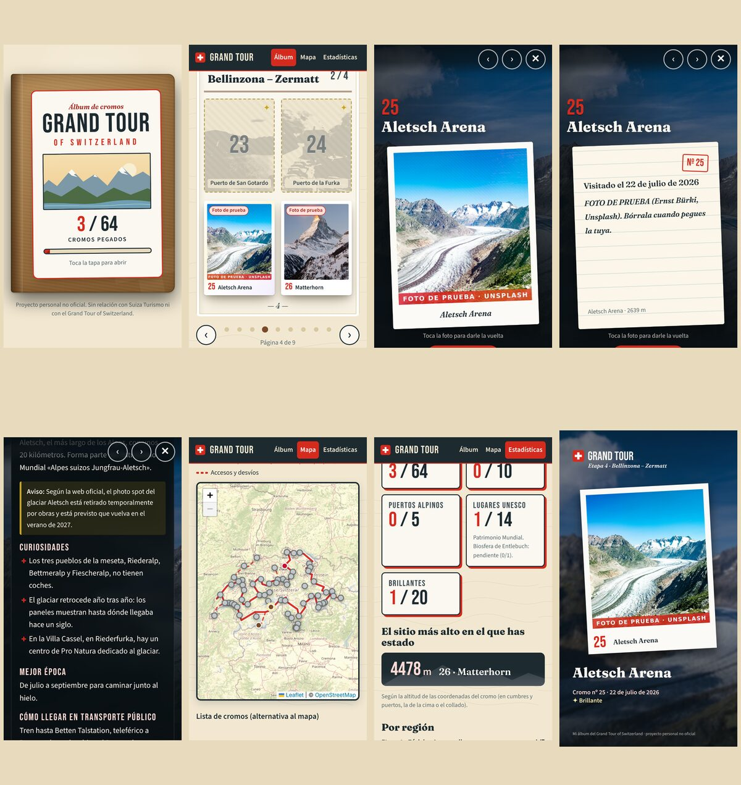

# Álbum de cromos del Grand Tour of Switzerland

Mi álbum personal de cromos del **Grand Tour of Switzerland**: 64 sitios, cada uno es un cromo, y cuando lo visito pego mi propia foto.

👉 **Web:** https://mario2002pd-create.github.io/Grand-Tour-of-Switzerland-Album/

> **Proyecto personal no oficial.** No tiene relación con Suiza Turismo ni con la marca Grand Tour of Switzerland y no usa sus logotipos.
> El repositorio es **público**: las fotos y notas que subas serán visibles para cualquiera.

## Qué hay dentro



| Pantalla | Qué hace |
| --- | --- |
| **Portada** | Tapa de cartón con el contador «X / 64 cromos pegados». Se toca y el álbum se abre. |
| **Álbum** | Una página por etapa oficial (8 etapas + accesos). Se pasa con swipe, flechas o ← →. Buscador y filtros por categoría y región. |
| **Ficha** | Foto del sitio a pantalla completa, tu foto como polaroid que gira (detrás: fecha y nota), datos, curiosidades, mejor época, cómo llegar en transporte público, mini mapa, enlace oficial y crédito de la foto. Botón **Compartir cromo** → imagen 1080×1920 para Instagram Stories. |
| **Mapa** | Suiza con Leaflet + OpenStreetMap, trazado aproximado del Grand Tour y un pin por cromo (de color si lo tienes, gris si no). |
| **Estadísticas** | Cromos por región y categoría, lagos, puertos y lugares UNESCO conseguidos y el sitio más alto en el que has estado. |

Los 20 cromos **brillantes** (✦: los 14 de Patrimonio Mundial, la Biosfera de Entlebuch y los 5 puertos) tienen efecto holográfico que reacciona al ratón o al giroscopio. En iPhone hay que pulsar **«Activar brillo con movimiento»** una vez para dar permiso.

## Cómo añadir una foto

Cada cromo puede tener **varias fotos**; una de ellas es la **portada** (la que se ve pegada en el álbum). Las demás aparecen como miniaturas en la ficha.

### Opción 0: desde la web, en el móvil o el ordenador (la más cómoda)

La web puede guardar tus fotos directamente en este repositorio. Solo hay que conectarla una vez en cada dispositivo:

1. En el álbum pulsa **Conectar GitHub**.
2. Crea un token en GitHub (el diálogo lleva el enlace): *Fine-grained token* → **Repository access: Only select repositories → Grand-Tour-of-Switzerland-Album** → **Permissions → Contents: Read and write** → *Generate token*.
3. Pega el token y pulsa **Conectar**.

A partir de ahí, en la ficha de cada cromo tienes **Pegar mis fotos**, **Añadir fotos** (puedes elegir varias a la vez), **Cambiar foto**, **★ Usar de portada**, **Borrar foto** y **Fecha y nota**. En el álbum, cada cromo pegado tiene además un botón **⟳** para cambiar su foto de portada.

- Las fotos se reducen a 1600 px y se les **quita el GPS y el resto de metadatos** en tu navegador antes de subirlas.
- Cada cambio es un commit en `main`: la web se vuelve a publicar sola y lo verás en todos tus dispositivos en 1–2 minutos (en el dispositivo conectado lo ves al momento).
- El token se guarda solo en ese navegador. Para quitarlo: **✓ GitHub conectado → Desconectar**, y si quieres, revócalo en GitHub (*Settings → Developer settings → Personal access tokens*).
- Los visitantes que no tengan tu token pueden ver el álbum, pero no cambiar nada.


### Opción 1: `npm run pegar` (recomendada)

Necesitas [Node.js](https://nodejs.org) 20 o superior. La primera vez:

```bash
npm install
```

Después, cada vez que visites un sitio:

```bash
npm run pegar
```

Te pregunta el cromo (por id, como `matterhorn`, o por número, como `26`), la ruta de la foto (puedes arrastrarla a la terminal) y una nota. El script:

1. redimensiona la foto a 1600 px como máximo y la guarda en `fotos/<id>-<código>.jpg`, **añadiéndola** a las fotos del cromo (te pregunta si es la nueva portada; sin preguntas lo es, salvo con `--no-portada`);
2. lee la **fecha del EXIF** (puedes cambiarla);
3. **borra todos los metadatos** de la foto publicada, **GPS incluido**;
4. marca el cromo como `visitado: true` y actualiza `data/cromos.json`.

Sin preguntas:

```bash
npm run pegar -- --cromo 26 --foto ~/Fotos/IMG_1234.jpg --nota "¡Por fin despejado!"
```

Luego sube los cambios:

```bash
git add fotos data && git commit -m "Pego el cromo 26" && git push
```

### Opción 2: a mano

1. Sube tu foto a `fotos/<id>.jpg` (por ejemplo `fotos/matterhorn.jpg`). **Quítale antes el GPS**: el repositorio es público.
2. Edita el cromo en `data/cromos.json` (`fotos` es la lista de todas tus fotos y `foto_mia`, la de portada):

```json
"fotos": ["fotos/matterhorn.jpg", "fotos/matterhorn-2.jpg"],
"foto_mia": "fotos/matterhorn.jpg",
"fecha_visita": "2026-07-24",
"nota_personal": "Amanecer desde el Riffelsee",
"visitado": true
```

### Opción 3: «Modo vista previa» en la web

En el álbum pulsa **Modo vista previa** y arrastra una foto a un hueco (o abre la ficha y pulsa **Probar foto**). Verás cómo queda, con la fecha leída del EXIF. Se guarda **solo en tu navegador** (IndexedDB), no se sube a ningún sitio.
Cuando te guste, pulsa **Exportar JSON**: descarga un `cromos.json` con esos cromos marcados como visitados y, para cada uno, la foto ya reducida y sin metadatos (`<id>.jpg`). Sube las fotos a `fotos/` y sustituye `data/cromos.json`.

### Quitar los 3 cromos de prueba

El álbum trae pegados **Grossmünster, Aletsch Arena y Matterhorn** con fotos de prueba de Unsplash (marcadas con «FOTO DE PRUEBA» y la etiqueta *Foto de prueba*). Para quitarlas:

```bash
npm run pegar -- --quitar-pruebas
```

(O despega un cromo concreto con `npm run pegar -- --quitar 26`.) Si pegas tu foto en uno de esos cromos, la de prueba se sustituye sola.

## Cómo publicar

La web se publica sola en GitHub Pages con GitHub Actions cada vez que se actualiza la rama `main`.

**Solo la primera vez:** en GitHub, ve a **Settings → Pages → Build and deployment → Source** y elige **GitHub Actions**.

La dirección es https://mario2002pd-create.github.io/Grand-Tour-of-Switzerland-Album/

Para probar en tu ordenador:

```bash
npm run dev          # servidor de desarrollo
npm run build        # genera dist/
npm run preview      # sirve dist/ en http://localhost:4173/Grand-Tour-of-Switzerland-Album/
npm run validar      # comprueba que los 64 cromos tienen todos los campos
```

## Cómo cambiar textos

- **Textos de cada cromo** (nombre, descripción, curiosidades, mejor época, cómo llegar, avisos): `data/i18n/es.json`, dentro de `"cromos"`, por id.
- **Textos de la interfaz**, nombres de regiones, categorías y cantones: el mismo archivo, en `"ui"`, `"regiones"`, `"categorias"` y `"cantones"`.
- **Datos que no dependen del idioma** (coordenadas, altitud, cantón, categoría, rareza, enlace oficial, crédito de la imagen) y **tus campos** (`foto_mia`, `fecha_visita`, `nota_personal`, `visitado`): `data/cromos.json`.
- **Orden y color de las regiones, categorías y trazado del mapa:** `data/album.json`.

### Añadir alemán o inglés

Copia `data/i18n/es.json` como `de.json` o `en.json` y traduce los valores (no las claves). Al cargar, la web une `cromos.json` con el archivo del idioma; el idioma activo se elige en `src/data.js` (`IDIOMA`). `npm run validar` avisa de los textos que falten.

## Imágenes de fondo

Cada cromo tiene una foto libre de **Wikimedia Commons** en `img/fondos/<id>.webp` (1600 px), una miniatura `<id>-mini.webp` y una silueta gris generada automáticamente a partir de la foto en `img/siluetas/<id>.webp`. El autor, la licencia y la URL de origen están en `data/cromos.json` (`imagen`) y se muestran en cada ficha. No se enlaza nada en caliente: todo se sirve desde este repositorio.

Para regenerarlas o añadir las de un cromo nuevo:

```bash
npm run fondos                 # descarga y optimiza solo las que faltan
npm run fondos -- --forzar     # lo regenera todo
```

Si tu red limita las descargas de Wikimedia, la Action **«Descargar fondos»** (pestaña *Actions → Descargar fondos → Run workflow*) hace lo mismo en GitHub y guarda las imágenes en el repositorio. El despliegue también completa las que falten antes de construir.

## Datos y fuentes

- **Lista de sitios:** los 46 highlights oficiales del Grand Tour en MySwitzerland (entre ellos el San Gotardo), más 14 photo spots oficiales y 4 puertos alpinos añadidos. Las regiones son las 8 etapas oficiales más una página de accesos.
- **Puertos:** Flüela, Julier, San Bernardino, San Gotardo y Furka proceden de Routard; la página oficial de [puertos alpinos del Grand Tour](https://www.myswitzerland.com/en-ch/experiences/experience-tour/car-motorcycle-grand-tour/facts-about-the-grand-tour-of-switzerland/alpine-passes/) confirma esos cinco con sus altitudes. Lucerna Turismo cita también Klausen y Oberalp, que no están en el álbum.
- **Aletsch:** según la web oficial, el photo spot del glaciar está retirado por obras hasta el verano de 2027.
- **Coordenadas:** comprobadas con el buscador de swisstopo y Wikidata. **Altitudes:** modelo de elevación de swisstopo en esas coordenadas, salvo cumbres, estaciones y puertos con cifra oficial (Säntis 2502, Jungfraujoch 3454, Matterhorn 4478, Muottas Muragl 2456, Rigi Kulm 1798 y los cinco puertos).
- **Mapa:** © colaboradores de OpenStreetMap. El trazado es **aproximado** y está dibujado con puntos de paso propios; no es el GPX oficial.
- **Fotos de prueba:** Unsplash (Rico Reutimann, Ernst Bürki, Nils Leonhardt), con la licencia de Unsplash.

## Estructura

```
data/cromos.json        64 cromos (datos + tus campos)
data/i18n/es.json       textos en español
data/album.json         regiones, categorías y trazado del mapa
fotos/                  tus fotos (<id>.jpg)
img/fondos/, siluetas/  fotos de fondo y siluetas
scripts/                pegar, fondos y validar
src/                    la web (Vite + JavaScript, sin framework)
```
